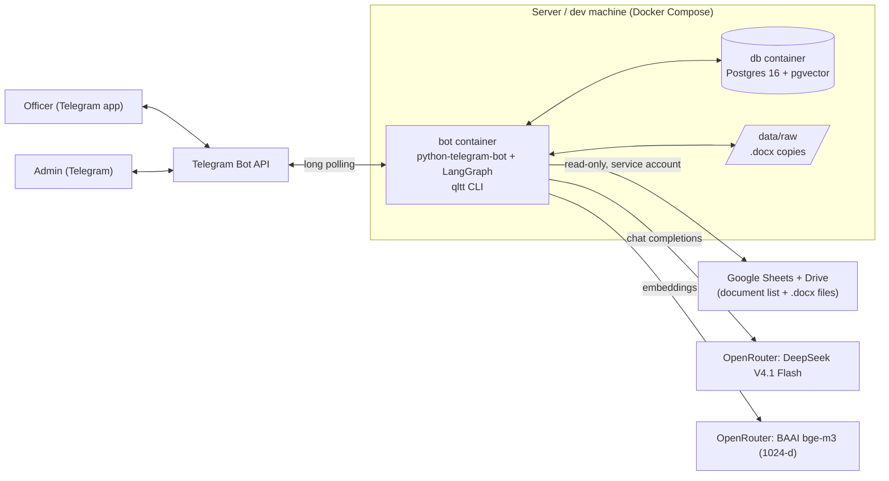
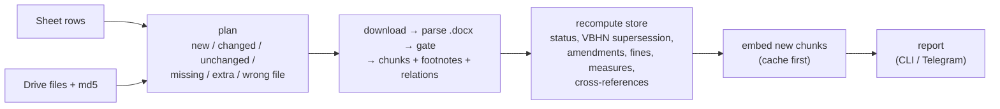
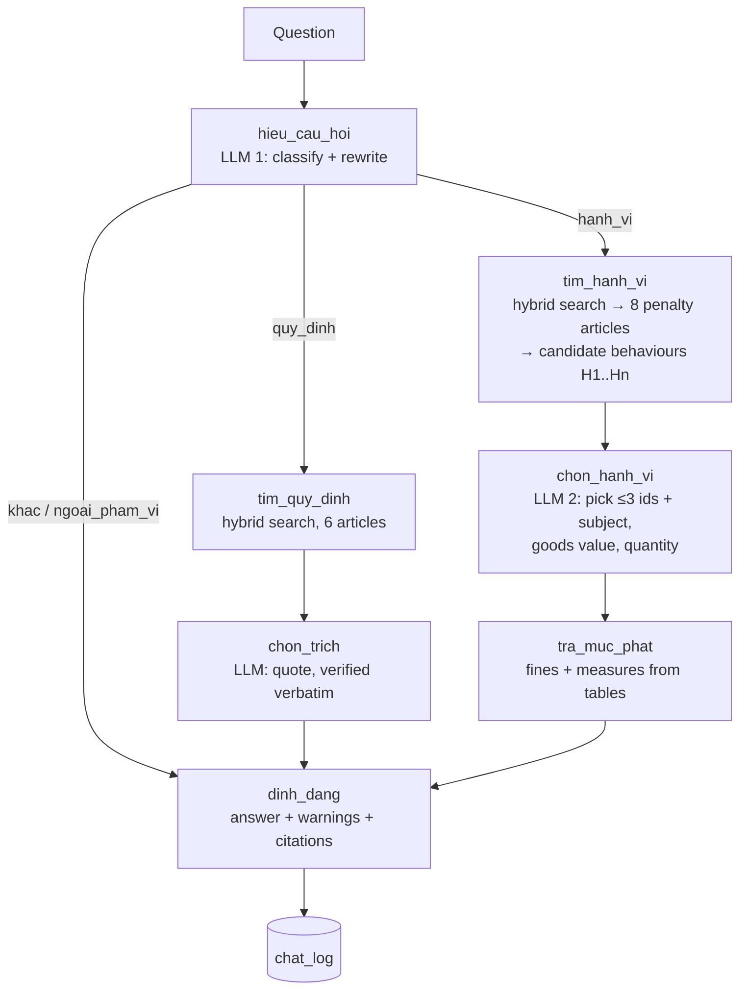

# qltt-bot

A Telegram bot that helps a Vietnamese market-surveillance officer (QLTT) look up administrative
penalties. The officer types a situation in plain Vietnamese; the bot answers with the violation,
the fine (by value / quantity, individual vs. organisation), aggravating circumstances, additional
penalties, remedial measures, and the legal basis cited down to the point (điểm), in the wording
used in official violation reports.

Documents come from thuvienphapluat.vn (TVPL). The officer maintains the document list in a Google
Sheet and the .docx files in a Google Drive folder; the bot reads both (read-only) and keeps
everything else in Postgres.

## System architecture



One Python process (`qltt bot`) serves Telegram, runs the answer pipeline and the sync; one
Postgres database holds documents, vectors, derived tables, caches and logs. There is no web
server and no inbound port: every connection is outbound. The officer owns the source of truth
(Sheet + Drive); everything in the database except logs can be rebuilt from it.

### Data flow: sync (ingestion)



### Data flow: answering a question



## Detailed design

**Parsing.** `python-docx` reads TVPL .docx files into header (number, date, type), articles,
clauses, points and appendices. Consolidated texts (VBHN) carry footnote markers `[n]` and a
footnote list; each footnote is attached to the chunk and, when placed on a point, to that point
(`chu_thich_vbhn.diem`). A gate rejects a file whose structure looks wrong (numbering gaps, wrong
document number/date) and keeps the previous version in use.

**Chunks.** Two levels: whole article and each clause, plus list-type appendices. Each chunk gets
a role (`xu_phat`: names a violation with a fine; `quy_pham`: a rule) and a type (violation,
additional penalty, remedial measure, definitions, scope, …). Embedded text is prefixed with its
document/article context. Postgres `tsvector('simple')` with a GIN index serves keyword search.

**Document status.** Recomputed for the whole store on every sync from the sheet dates and today:
in force / not yet / expired. A document is used for lookup only if it is in force, not superseded
by a VBHN in force (the base decree and amendments already consolidated are then read through the
VBHN), not replaced or repealed by a document in force (read from the "entry into force" article),
and still on the sheet.

**Amendments.** Two sources. (1) Amending documents are parsed instruction by instruction
("khoản 3 Điều 6 được sửa đổi như sau: …", appendix lines, "không thực hiện …" in resolutions)
into `sua_doi_chi_tiet` (action, target article/clauses, new text). (2) VBHN footnotes record
amendments already consolidated. An amendment newer than the VBHN in use, or for a document with
no VBHN, becomes a ⚠️ warning on the answer; temporary suspensions by resolutions are warnings
only and never part of the legal basis.

**Fines and measures.** `muc_phat` parses each penalty clause into tiers: range per individual /
organisation, conditions by goods value or quantity, warnings, "N times" multipliers
(aggravating cases); `bien_phap` maps additional penalties and remedial measures to the clauses
they apply to. The answer reads amounts from these tables; the LLM never writes a number.

**Search.** Hybrid: exact vector search (pgvector, cosine, full scan, no ANN index at ~22k chunks)
and full-text search, 50 candidates each, merged with Reciprocal Rank Fusion (k = 60, keyword
weight 0.5). Search runs on both the original and the rewritten question. Penalty search is
restricted to `xu_phat` chunks of documents in use; definitions and related rules are fetched
separately as context.

**Answering.** LLM 1 classifies (`hanh_vi`, `quy_dinh`, `ngoai_pham_vi`, `khac`) and rewrites
everyday wording into legal terms (prompt v5, with definitions drawn from the store). For
violations, candidate behaviours from the top 8 articles get ids H1..Hn; LLM 2 only picks ids
(unknown ids are rejected and retried once) and extracts subject, goods value and quantity; code
then selects the fine tier. For rule questions, quotes are checked character by character against
the source; a failed quote falls back to the whole clause.

**Citations.** `can_cu` builds report-style legal basis down to the point: base decree plus each
amendment ("được sửa đổi, bổ sung tại …"), from the footnotes on the article (except title-only
footnotes), the clause and the point, plus unconsolidated amendments, ordered by issue date. The
"📋 Quy định tại" message lists one block per item (violation, fine, aggravating, additional
penalty, remedial measure) and links every related document (VBHN, base, amending, suspending,
cross-referenced; TVPL search link when not in the store).

**Feedback and observability.** Every answer is stored in `chat_log` with a per-step trace
(input, output, time, tokens, cost). "⚠️ Báo sai" records the error type and the officer's
correct basis; the admin receives errors, reports, `/dongbo` reports and a live copy of each
question. `qltt nhat-ky --theo-doi` follows the log from a terminal; reports can be turned into
eval cases.

**Cost and caching.** Embeddings are cached by content hash and model (`embed_cache`), so
re-parsing or switching models back costs nothing; LLM calls are cached by prompt version and
input (`llm_cache`), so repeated questions cost nothing. Each answer logs its real cost (from
OpenRouter usage). OpenRouter requests set `provider.data_collection: deny`.

**Security.** Bot replies only to chat_ids in `TELEGRAM_CHO_PHEP`. Google access is a read-only
service account (Viewer on one folder). Secrets live in `.env` and `secrets/`, mounted into the
container at run time, never in the image or git. Postgres is not exposed on servers.

**Quality.** ~280 pytest tests (parsing, gate, amendments, citations, fines, sync, bot flows on
a real Postgres test database) and an evaluation set (`eval/cases.jsonl`) measuring search
recall, classification, behaviour selection and rule answers on everyday questions.

## Tech stack

| Layer | Choice |
|---|---|
| Language, packaging | Python 3.12, uv, hatchling |
| Chat interface | Telegram via python-telegram-bot 22 (long polling, HTML messages, inline keyboards) |
| Orchestration | LangGraph (answer graph), plain Python modules for each step |
| LLM | DeepSeek V4.1 Flash via OpenRouter (OpenAI-compatible `openai` client), reasoning off |
| Embeddings | BAAI bge-m3 via OpenRouter, 1024 dimensions |
| Database | PostgreSQL 16 + pgvector 0.8.7, unaccent, pg_trgm; psycopg 3 |
| Search | pgvector cosine + Postgres full-text, RRF fusion |
| Documents | python-docx; sources from thuvienphapluat.vn |
| Google | google-api-python-client + google-auth (service account, Sheets + Drive read-only) |
| CLI, config | Typer, pydantic-settings (`.env`) |
| Deployment | Docker, Docker Compose (`db` + `bot`, restart unless-stopped) |
| Quality | pytest, ruff, custom eval harness |

## Requirements

- uv: https://docs.astral.sh/uv/
- Docker (Docker Desktop on Windows / macOS)
- An OpenRouter API key (LLM + embeddings), a Google service account, a Telegram bot token

## First run (development)

```
uv sync
copy .env.example .env        (macOS / Linux: cp .env.example .env)
```

Fill in `.env` (at least `POSTGRES_PASSWORD`, `LLM_API_KEY`, `SHEET_ID`, `FOLDER_ID`; Telegram
settings for the bot). Then:

```
docker compose up -d --wait db
uv run qltt db init
uv run pytest
uv run qltt dong-bo
uv run qltt hoi "bán bánh kẹo trị giá 7 triệu không có nhãn"
```

If port 5432 is taken, set `DB_PORT` in `.env` (e.g. 5433). The Postgres password is applied only
when the volume is first created; changing it in `.env` later does not change it in Postgres.

Never commit `.env`, `secrets/` or `data/` (all in `.gitignore`). Never paste keys or tokens into
chat.

## Telegram bot

```
uv run qltt bot
```

`.env`:

| Variable | Meaning |
|---|---|
| `TELEGRAM_TOKEN` | from @BotFather |
| `TELEGRAM_CHO_PHEP` | comma-separated chat_ids allowed to use the bot; others are ignored and their chat_id is logged |
| `TELEGRAM_ADMIN` | chat_id that receives errors, error reports, `/dongbo` reports and copies of questions (empty: none) |
| `TELEGRAM_THEO_DOI` | `true` (default): admin gets a copy of every question and answer from other users |
| `TELEGRAM_PROXY` | optional proxy if api.telegram.org is blocked |

Bot commands: `/start`, `/help`, `/dongbo` (sync), `/vanban <document number>` (status of a
document, e.g. `/vanban 98/2020/NĐ-CP`). Buttons under each answer: "📋 Quy định tại" (full legal
basis, tap to copy) and "⚠️ Báo sai" (report an error).

To run it 24/7 on a VPS or a home server, see [DEPLOY.md](DEPLOY.md).

## CLI

| Command | What it does |
|---|---|
| `qltt db init [--xoa-dan-xuat]` | create extensions, tables, indexes (idempotent); `--xoa-dan-xuat` drops derived tables first |
| `qltt google kiem-tra` | test access to the Sheet and Drive folder, match TVPL ids on both sides |
| `qltt google tai` | download .docx files that have no local copy (`data/raw/{id}/{md5}.docx`) |
| `qltt parse kiem-tra` | parse downloaded files, run the gate, write `data/parse/{id}.json` |
| `qltt nap [--lam-lai]` | sync without embeddings; `--lam-lai` re-parses unchanged files |
| `qltt dong-bo [--full] [--khong-embed]` | full sync: plan, load changes, recompute, embed, report |
| `qltt embed` | embed chunks that have no vector yet (cache first, pay only for misses) |
| `qltt van-ban [query]` | list documents: in use or why not, amended / suspended by which documents |
| `qltt hoi "question"` | ask like the officer would; prints answer, timing, cost; logs to chat_log |
| `qltt nhat-ky [--so N] [--theo-doi] [--tat-ca]` | show what users asked and what the bot answered; `--theo-doi` follows live |
| `qltt bot` | run the Telegram bot (long polling) |
| `qltt tim "question"` | show search candidates for one question |
| `qltt sua-doi [--van-ban]` | rebuild amendment relations; report amendments not in any VBHN |
| `qltt dan-chieu [--tat-ca]` | rebuild cross-references; report referenced documents missing from the store |
| `qltt muc-phat` | rebuild fine and measure tables; report coverage |
| `qltt do-thi` | print the answer graph (Mermaid) |
| `qltt bao-sai them / ds / xu-ly / thanh-case` | record, list, close error reports; turn them into eval cases |
| `qltt eval kiem-tra / tim-kiem / phan-loai / tra-loi / quy-dinh / tong` | evaluation (see `eval/README.md`) |
| `uv run pytest` | tests; DB tests use a separate `qltt_test` database and are skipped if Postgres is down |
| `uv run ruff check .` / `uv run ruff format .` | lint and format |

## Layout

```
src/qltt/
  config.py      settings from environment / .env
  db.py          connection, schema init, table categories
  schema.sql     all tables
  tvpl.py        TVPL document id from links and file names
  google_io.py   read the Sheet, list and download Drive files (read-only)
  kho_file.py    local copies of .docx files
  parse.py       .docx → header, articles, clauses, points, appendices, VBHN footnotes
  gate.py        post-parse sanity checks
  chunk.py       article / clause chunks and their roles
  nap.py         load one document; recompute status for the whole store
  dong_bo.py     Sheet + Drive → DB sync, report, document status
  sua_doi.py     amendment relations and per-clause amendment details, warnings
  dan_chieu.py   cross-references to other documents
  muc_phat.py    fine table (tiers by value / quantity, multipliers)
  bien_phap.py   additional penalties and remedial measures
  can_cu.py      "Quy định tại" legal-basis strings in report style
  embed.py       embeddings via an OpenAI-compatible API (OpenRouter)
  tim_kiem.py    hybrid search (vector + full-text, RRF)
  viet_lai.py    question rewriting and classification (LLM)
  ngu_canh.py    context for the selection step
  tra_loi.py     answer one question (violation flow, plain-text output)
  quy_dinh.py    answer questions about regulations, verify quotes
  do_thi.py      LangGraph wiring
  llm.py         LLM calls with cache, token and cost tracking
  hien_thi.py    Telegram HTML answer and the "Quy định tại" message
  nhat_ky.py     chat_log and error reports
  bot.py         Telegram bot
  cli.py         `qltt` command
tests/
eval/                    evaluation cases (see eval/README.md)
compose.yaml             Postgres 16 + pgvector, and the bot service for servers
compose.override.yaml    dev only: expose Postgres on 127.0.0.1
Dockerfile               bot image
docs/, scripts/          survey data and scripts (Nov 2026), not part of the package
```

## Table categories

| Category | Tables | Rule |
|---|---|---|
| Derived | van_ban, chunk, sua_doi, sua_doi_chi_tiet, chu_thich_vbhn, quan_he_van_ban, dan_chieu, muc_phat, bien_phap | rebuilt from Sheet + Drive; rebuild commands may drop them |
| Source | chat_log, bao_sai, xac_nhan, nhat_ky_dong_bo | cannot be rebuilt; never dropped automatically; must be backed up |
| Cache | embed_cache, llm_cache | rebuildable but costs API money; kept across rebuilds |

Source and cache tables have no foreign keys to derived tables and do not store their
auto-increment ids. When adding a table, declare it in `schema.sql` and categorise it in `db.py`
(a test fails if you forget).

## Google Cloud (one-time, with the officer's Google account)

1. Go to https://console.cloud.google.com and create a project.
2. Enable the Google Sheets API and Google Drive API for it
   (https://developers.google.com/workspace/guides/enable-apis).
3. IAM & Admin > Service Accounts > Create service account. Name it, click Done. No role needed.
4. Open the service account > Keys > Add key > Create new key > JSON. The downloaded file is the
   only copy.
5. Save it as `secrets/google-sa.json` in the repo. Never send it by chat, email or git.
6. In Drive, share the documents folder with the service account email as Viewer.
7. In `.env`, set `SHEET_ID` (between `/d/` and `/edit` in the sheet link) and `FOLDER_ID` (after
   `/folders/` in the link of the "Văn bản" subfolder).
8. Run `uv run qltt google kiem-tra`. Done when it reports all 7 columns and the file count matches
   the sheet rows.

If step 4 says key creation is not allowed, the account belongs to an organisation that blocks
service-account keys; stop and ask for help.
